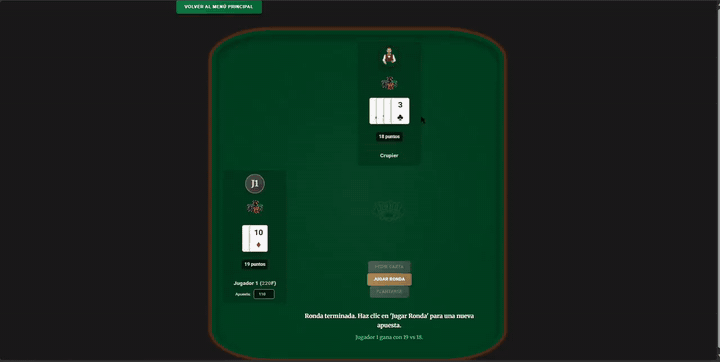

<div align="center">

# BlackJack Royale

**Casino en el navegador con el juego de BlackJack: modo contra la máquina, multijugador en tiempo real y banco de fichas.**

-F7DF1E?style=flat-square&logo=javascript&logoColor=black)


### [▶ Jugar ahora](https://luism7p7.github.io/BlackJack/Casino/public/)



</div>

## ¿Qué hace?

- **Contra la máquina:** apuestas, pedir carta, plantarse y reglas completas de BlackJack contra el crupier.
- **Multijugador en tiempo real:** varios jugadores en la misma mesa, sincronizados con un servidor de WebSockets.
- **Banco:** pedir fichas prestadas y pagarlas después.
- **Progreso guardado:** las fichas de cada jugador se guardan en el navegador.

## Cómo está hecho

El front-end está dividido en módulos de JavaScript con una responsabilidad cada uno:

```
Casino/
├── public/
│   ├── index.html, games/blackjack.html, games/banco.html
│   └── js/modules/
│       ├── Deck.js            baraja y reparto
│       ├── Player.js          jugador, mano y fichas
│       ├── BlackjackGame.js   reglas y flujo de la partida
│       ├── UIManager.js       todo lo que se dibuja en pantalla
│       ├── StorageManager.js  guardado en localStorage
│       └── SocketClient.js    conexión con el servidor multijugador
└── server/
    ├── server.py              servidor asyncio + websockets
    └── test_server.py         pruebas del servidor
```

## Cómo ejecutarlo

**Un jugador:** abre la [demo en línea](https://luism7p7.github.io/BlackJack/Casino/public/) o sirve la carpeta `Casino/public` con cualquier servidor estático (por ejemplo, Live Server de VS Code).

**Multijugador:**

```bash
pip install websockets
python Casino/server/server.py
```

Luego cambia la dirección `SERVER_URL` en `Casino/public/js/modules/SocketClient.js` por la IP del computador donde corre el servidor.

## Equipo

Proyecto de clase hecho en equipo. Todos participamos en cada parte: el front-end en HTML, CSS y JavaScript, el servidor multijugador en Python y sus pruebas.

| Integrante | Enlaces |
| :-- | :-- |
| **Luis Miguel Muñoz Rendón** | [GitHub](https://github.com/luism7p7) · [Portafolio](https://luism7p7.github.io) |
| **Alexander Mejía Ospina** | [GitHub](https://github.com/AlexanderM-Code) · [Portafolio](https://alexanderm-code.github.io) |
| **Santiago Rodríguez** | [GitHub](https://github.com/santiago12R) |

---

Proyecto en equipo · participación de **Luis Miguel Muñoz Rendón** · [Portafolio](https://luism7p7.github.io) · [LinkedIn](https://www.linkedin.com/in/luismiguelmu%C3%B1ozrendon)
